# Whack-a-Math

Learn maths through curriculum activities, animated worked solutions, and a five-choice whack-a-mole game. Whack-a-Math covers Ontario Grades 1–10, with local player profiles and saved progress. No LLM, API key, or backend is used. Recognition and solving are separate: a trained model transcribes ink; exact arithmetic rules solve supported formulas.

[](https://chris-kc-cheng.github.io/math/)

Live site: [chris-kc-cheng.github.io/math](https://chris-kc-cheng.github.io/math/)

## Screenshots

Practice offers **Whack-a-Math**, a full-window five-choice quiz with green grass, holes, and five cute mole characters. Click an answer mole to confirm: correct choices get a hammer bonk and dizzy stars; wrong choices escape. Every answer reveals its worked explanation. Choose Captain Patty in settings for the original game.

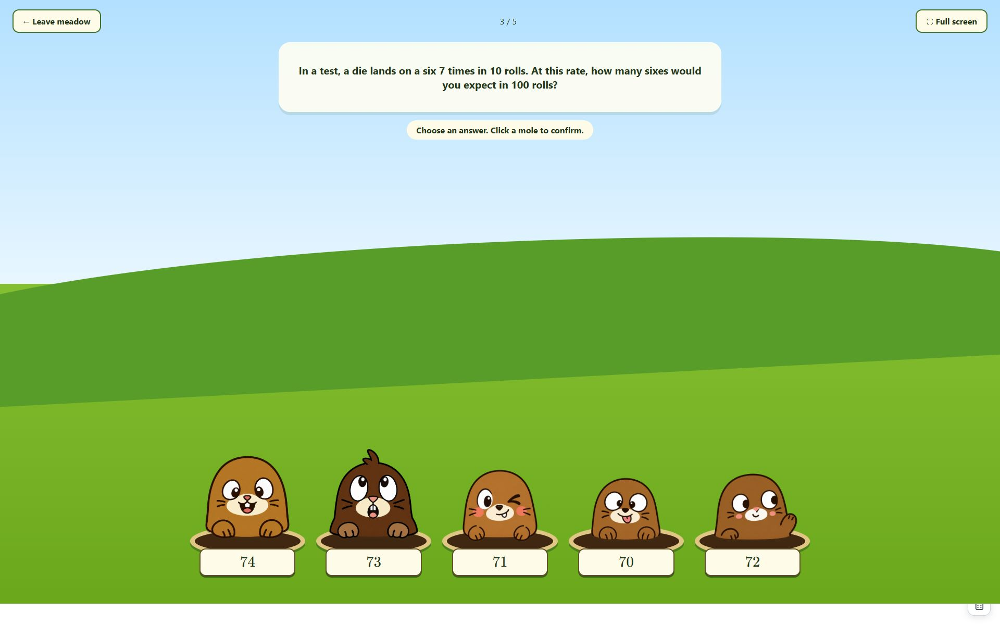

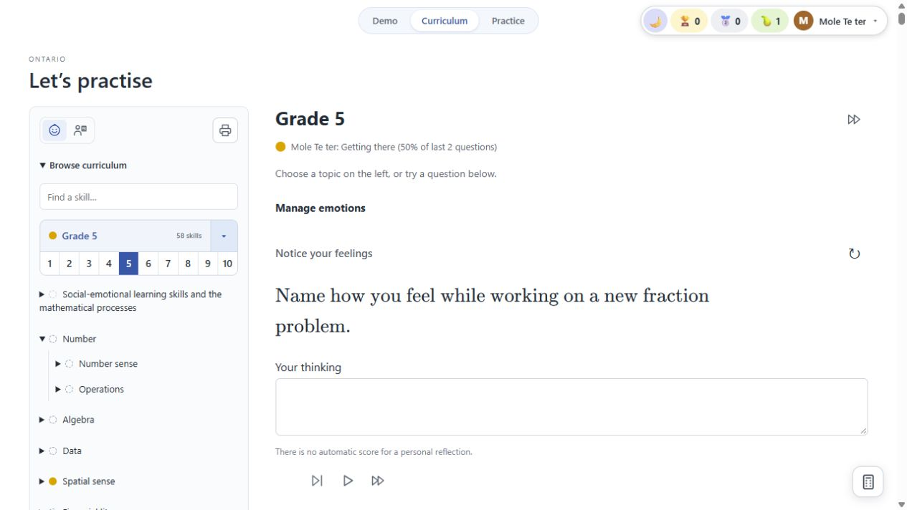

The player avatar menu offers 25 choices: the name initial and 24 emojis, including animals, two dinosaurs, and an alien.

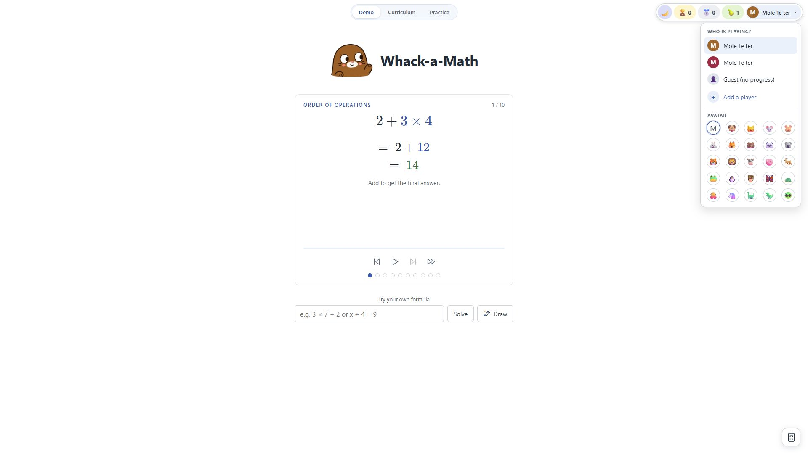


Animated worked examples, including extra room for stacked fractions:

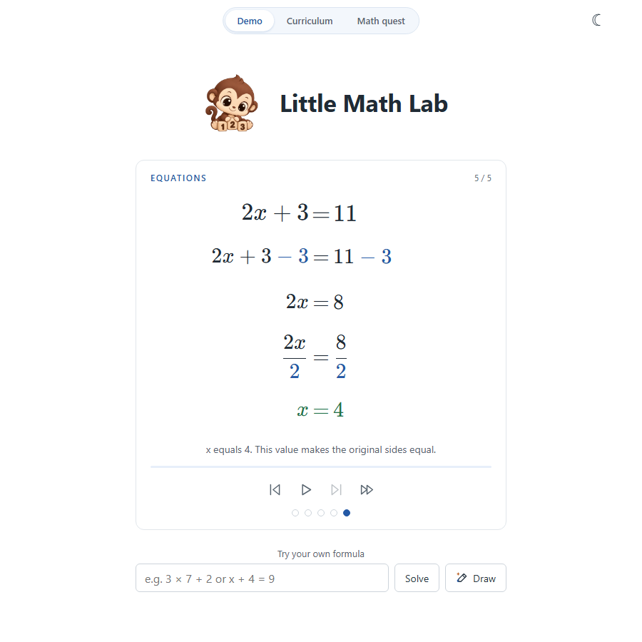

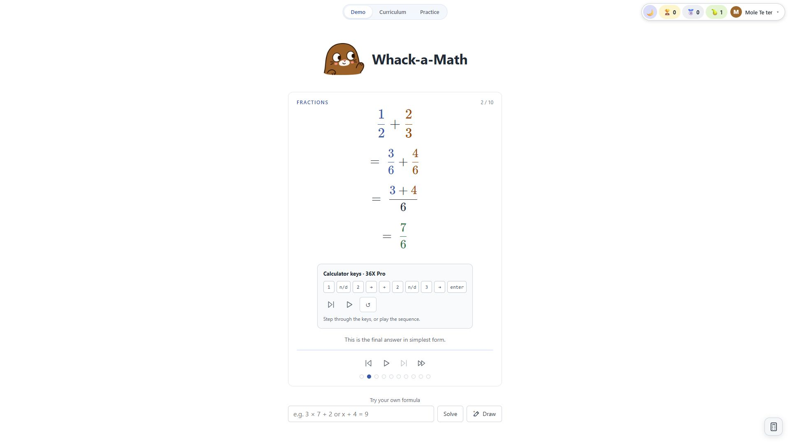

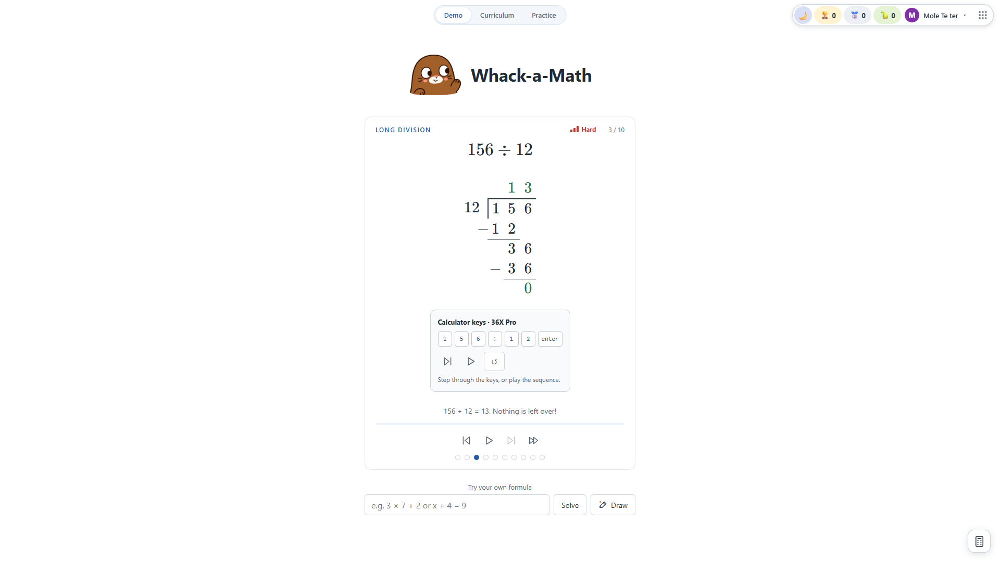

Browse Grades 1–10, use the connected grade buttons, and explore visual examples:


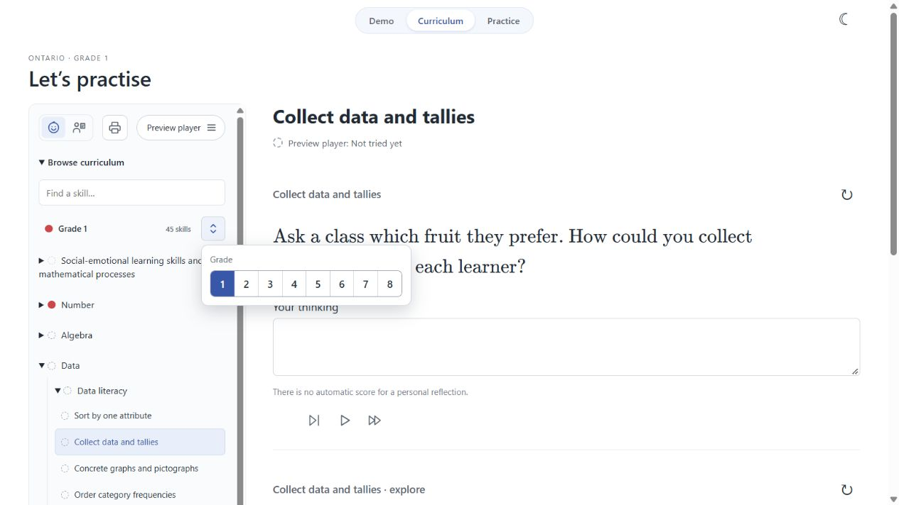

Choose a player from the badge in the top-right corner, then select a grade, topics, and round length:

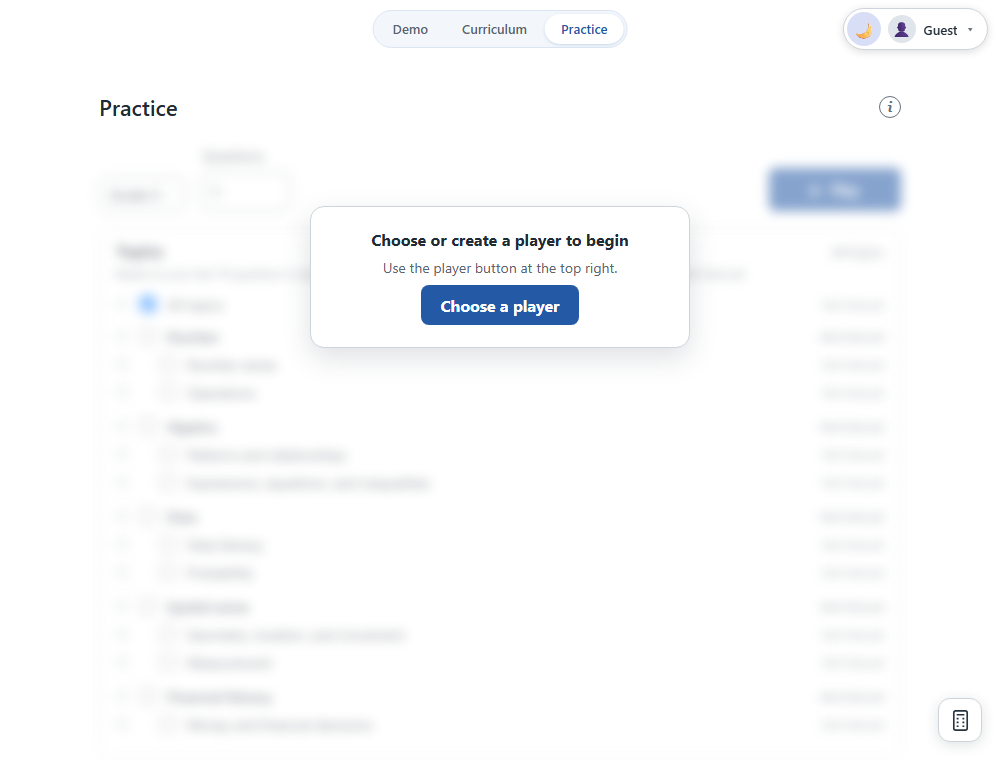

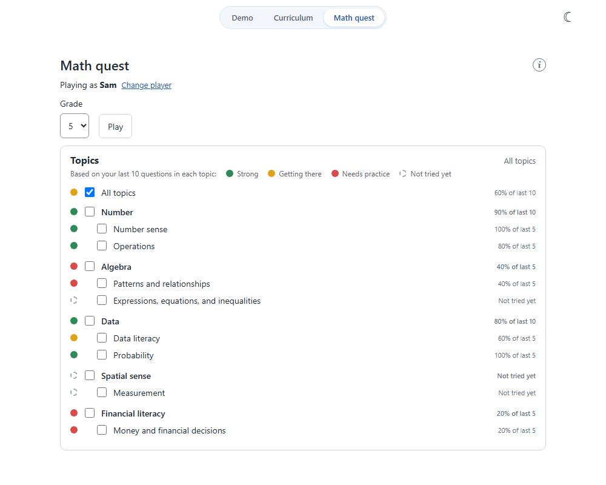

Every checked answer opens the explanation, with colour, an icon, and text indicating the result:


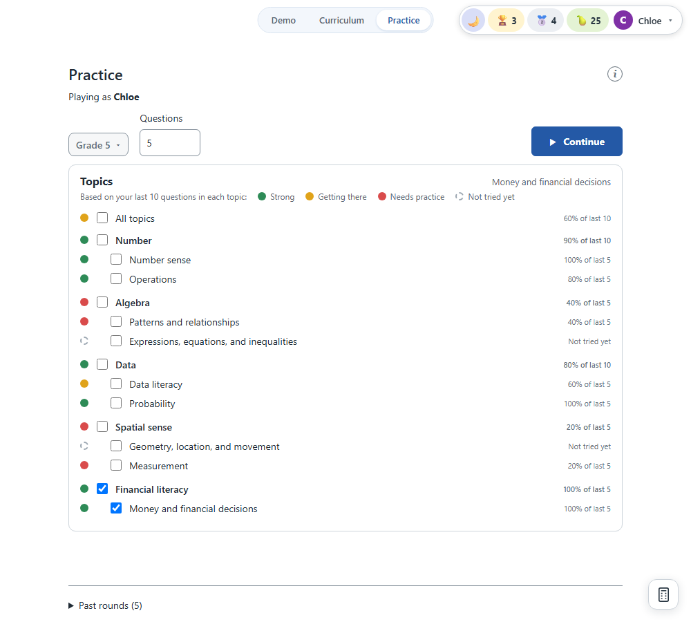

## GitHub Pages deployment

In the repository's **Settings → Pages**, choose **GitHub Actions** as the source. The [deployment workflow](.github/workflows/deploy-pages.yml) installs dependencies, runs tests, builds the site, and deploys `dist` after pushes to `main`. It can also be run manually from the **Actions** tab on `main`.

The workflow reads the Pages base path from GitHub, so assets and handwriting models work under `/math/` as well as a root or custom-domain deployment. No deployment secret or backend is required.

## Local development

Requires Node.js 20.19+ or 22.12+.

```sh
npm ci
npm run dev
npm test
npm run build
```

Use npm run preview to serve the production build. Open the printed local URL.

The landing page is a card slide show with one worked example per kind of math: order of operations, fractions, long division, long multiplication, and a one-variable equation. It plays automatically (one step about every 1.7 s, then a short hold before the next card). Pause stops it so the learner can step manually (Step, previous/next card, or the dots) or type or draw a formula under Try your own formula; focusing the formula box or opening the handwriting pad pauses automatically. With reduced-motion enabled the show starts paused and entry animations are suppressed.

The solver supports two signed integers/decimals with +, -, */×, or /÷; three-term addition with two grouping methods; the bounded a + b × c pattern; and a/b + c/d with integer fraction components. Simple LaTeX fractions and multiplication/division commands work. Simple equations ax + b = c with integer constants and x only on the left are also supported. Other mixed operations, general LaTeX parsing, more general algebra, powers, and roots are unsupported. Answers use reduced exact fractions; division by zero is rejected.

## Trained handwriting recognition

Open write.html via the Draw button. Draw a whole formula in the single pad and review the rendered formula, then Solve. Pen, Eraser, Undo, and Clear are icon controls inside the drawing box. Raw LaTeX and model descriptions are hidden. Read handwriting appears only when Live is off. Editing ink invalidates pending recognition so old results cannot overwrite a changed drawing. The math solver does not gain support for an operation merely because the recognizer can read it.

Recognition uses ink-on 0.1.0 with trained INT8 CoMER encoder/decoder weights and ONNX Runtime Web (CPU/WASM). It runs in a dedicated web worker; no handwriting leaves the browser. This is a specialized handwriting model, not an LLM. A backend is unnecessary. The initial load includes roughly 7.6 MB of model weights plus the WASM runtime. The model is cached in IndexedDB by ink-on; runtime files are bundled by Vite from the installed package, with no CDN dependency. Model provenance and license are in public/models/comer/.

The model supports full expression transcription, including stacked fractions. Recognition is experimental and can be wrong; accuracy on children's handwriting has not been measured. Sample ink is synthetic demonstration data, not an accuracy benchmark. The old geometric template matcher has been removed; sample-ink.js only supplies demo strokes.

npm test runs exact solver tests and a real encoder-to-decoder inference smoke test with the shipped model weights and vocabulary. The inference smoke test validates integration, not handwriting accuracy. Browser checks should additionally cover recognition, correction, stale results, errors, and subsequent solution steps.

Live recognition is enabled by default: after a 650 ms pause following a completed stroke, the latest ink is recognized. Only one inference runs at a time, with changed ink queued for the next pass and stale results discarded. Turn Live recognition off for manual-only reading. Pen/Eraser switches tools; dragging the eraser removes touched whole strokes. Undo restores the previous drawing or erasing gesture (up to 30 actions), including Clear. Use the eraser or redraw to correct the formula.

Landing workflow: watch the slide show, pause it, then type a formula under Try your own formula or open Draw to sketch it in a modal. `?slide=N` (1–10) opens a specific card. A grouped Demo / Curriculum / Practice switcher with the current page highlighted sits in the same top-centre position on every page, beside a frameless light/dark toggle. The handwriting module/model loads only on demand, and closing the modal terminates its worker and pending timers. Use formula transfers recognized LaTeX back to the landing lesson. The rendered selection is visible by default; Edit formula reveals a collapsed-by-default LaTeX/plain-text editor. The old write.html URL redirects to the landing page with the modal open. A tiny debug toggle at the top right opens a session-only right panel with the latest 400 app events, including resource loads, ink edits, debounce state, worker/model initialization, tensor dimensions, inference timings and tokens, stale-result rejection, exact solver outputs, caption steps, playback, and errors. Debug works while the handwriting modal is open and starts collapsed.

The collapsed Edit LaTeX panel is inside the handwriting modal and starts with the current selected formula. Manual edits update its rendered preview and invalidate pending recognition. Use formula applies the edited formula to the landing lesson. The solving section omits the original question and begins with the first transformation.

Long division appears in the main slide show (156 ÷ 12), and typing any `NN ÷ NN` with two-or-more-digit whole numbers in Try your own formula uses it too. A standalone long-division.html page is also available. Three examples autoplay divide, multiply, subtract, and bring down in a digit-aligned HTML/CSS layout. The separate BigInt algorithm supports nonnegative whole-number dividends up to six digits and positive divisors up to four digits, returning an integer quotient and remainder. Decimal expansion is not included. Tests check the quotient/remainder identity, zero quotient digits, invalid inputs, and immutable intermediate steps.

The curriculum.html page provides a searchable, selectable hierarchy for Grades 1–10 (Grade 5 has 58 expectation entries) with strand/topic overviews, skill descriptions, example activities, source links, and shareable selection hashes. Its shared hierarchy and question templates live in src/curriculum/data/. The curriculum inventory and suggested app learning path are separate; no public YRDSB preferred teaching order is claimed. All 58 entries now have worked or guided activities. Learner mode is the default; parent mode shows requirements, sources, and coverage. Refresh generates new questions; completed playback controls disappear.

Long multiplication appears in the main slide show (23 × 14), and typing two-or-more-digit whole numbers with × uses it too. Its separate exact integer rule handles 0–9999 for each operand, showing digit products, carries, shifted partial products, and column addition. Decimal and signed long multiplication are not included. Tests verify partial-product sums, final results, carrying, zero digits, and immutable snapshots.

The slide show's equation card (2x + 3 = 11), and typed equations such as x + 5 = 12 or 3x = 18, show inverse operations applied to both sides. Equation parsing runs before arithmetic normalization so x remains a variable. Constants must be signed integers; exact rational solutions, zero-coefficient identities, and contradictions are handled explicitly. Variables on both sides, decimal coefficients, arbitrary parentheses, powers, and fractional input constants are rejected.


The Grade 5 library provides worked and guided variants across all 58 entries, grouped by domain in src/math/grade5/. Shared tutorial, visual, and hands-on tools live in src/curriculum/. All calculations are deterministic and bounded; personal reflections and open-ended tasks are not automatically graded. Activities illustrate curriculum skills without claiming exhaustive coverage or mastery. See [src/README.md](src/README.md) for the architecture, named question parameters, tutorial contract, and extension workflow.

Grade 8 is available from the curriculum grade selector or `curriculum.html?grade=8`. Its researched hierarchy has 51 entries and rich question variants. The shared renderer, exact core and existing Grade 5 rules are reused. See [Grade 8 research](src/curriculum/data/grade-8-research.md) for official Ontario/YRDSB sources, source mapping and coverage limits.

Grades **4, 6, and 7** are also available in the same selector: `curriculum.html?grade=4`, `?grade=6`, and `?grade=7`. Their audited hierarchies contain 55, 58, and 59 expectation entries, with representative worked or guided activities for every entry. All grades use the shared learner/parent views, playback, page-wide fast-forward, dark mode, and exact arithmetic. New mathematical methods are grouped by domain in `src/math/elementary/`; grade-specific content and generation bounds remain in JSON. See [research and coverage audit](src/curriculum/data/grades-4-6-7-research.md). The activities remain partial coverage rather than a claim to assess every context, construction, or learner discussion.

## Question variety

A skill is practised in several ways so students are not just memorising one wording. `src/math/elementary/variants.js` adds exact-answer variants that take a `style` parameter: word problems with key-word hints for add, subtract, multiply and divide (six stems each, such as "sum", "decreased by", "how much more", "groups of", "shared equally"), missing-number boxes in six equation shapes (□ + a = b, a − □ = b, a × □ = b, and so on), compare-values questions (greater, less, how much greater) and place-value digit questions. They are attached to the whole-number skills in Grades 4–7 and are scored in Practice and the exercise sheets. A second batch (`src/math/elementary/variants-more.js`) adds textbook-style stems with key-word hints for fractions of a quantity, adding and subtracting fractions in words, decimals in money and measurement, percent of a quantity (discount, tip, increase), unit rates, multiply-then-add and think-of-a-number equations, pattern terms (next, nth, term number, missing term), area and perimeter of rectangles, squares, triangles and parallelograms, metric and time conversions, integers in temperature and bank contexts, powers and square roots, angle relationships, probability in several settings, and the mode or a missing value from the mean. These are attached to the matching skills in Grades 4–8. Every rule is exact, shows a relationship-then-calculation worked solution, and has a test that each style produces the correct answer. Three more batches (`variants-number.js`, `variants-space.js`, `variants-extra.js`) add rounding in context, fraction/decimal/percent conversions, simplifying and comparing fractions, GCF and LCM word problems, divisibility and prime-factor questions, order of operations, decimal patterns and pattern tables, inequalities, like terms, money change, best value, currency exchange, simple and compound interest, budgets, elapsed time, bar graphs and frequency tables read for totals, differences, means and fractions, experimental probability and sample spaces, circles with π ≈ 3.14, volumes and surface areas of prisms and cylinders, composite areas, Pythagorean problems, point transformations, scale lengths, polygon and turn angles, ratio sharing, how a mean changes, scientific notation, square-root estimates, signed integers, sale prices and debts. The Social-Emotional Learning strand is deliberately not given numeric variants. A coverage audit (templates and distinct wordings per skill) is recorded in the review log in `CLAUDE.md`, together with what is still thin.

## Printable exercise sheets

On the curriculum page, the printer icon at the top of the sidebar opens a dialog to build a hard-copy sheet. Choose any mix of strands and topics (or leave all unticked), the number of questions (default 10, up to 50), and whether the answer sheet should also show workings. The sheet lists numbered questions with answer lines, and the answers always come on the last page, either as a compact list or as full worked solutions with the same exact steps shown on screen. It uses the same single-answer questions as Practice (`src/worksheet-model.js`) and never repeats an identical question. **Create PDF** opens the browser print window on a light layout; choose *Save as PDF* as the destination to keep a file. No backend or PDF library is needed.

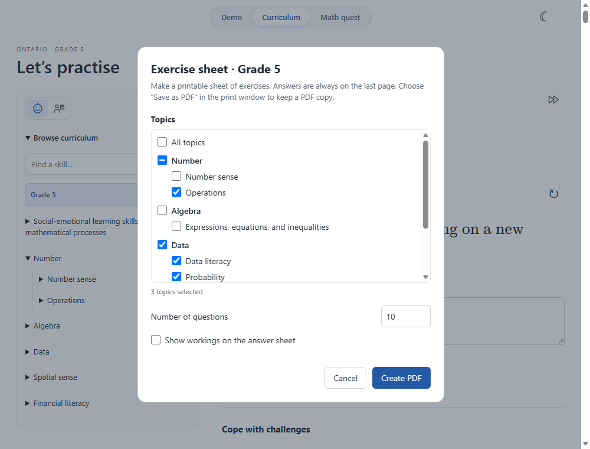

## Practice

`game.html` has no sign-in form of its own: players are chosen and added in the corner badge menu. A guest sees the settings blurred behind a prompt to choose or create a player first; a signed-in player goes straight to the settings. Then choose a grade, topics, and an editable round length of 1–50 questions (default 5). Returning players restore their last grade, topics, and round length. An unfinished round resumes only when those settings match. The coloured Play/Continue button sits at the right of the settings row; the question count is an editable number field.

Every valid submitted answer immediately shows the worked explanation. Correct answers receive a green check and 10 points; incorrect answers show a red cross, become explored examples, and earn no points. Invalid answer syntax does not consume a turn. The next-question button follows the explanation. Learners can also explore before answering, without a correctness score. Colours remain readable in dark mode, and the text/icons communicate the result without relying on colour alone.

Captain Patty fires ketchup at Grumble the zombie after a correct answer. Wrong answers cost one of his five lives; at zero he cries, and the round can continue. At least half the questions must be correct to win. Progress and rounds save in IndexedDB by player name; there is no account or backend. Reduced-motion preferences disable shot and zombie animations. Older saved retry scores remain readable.

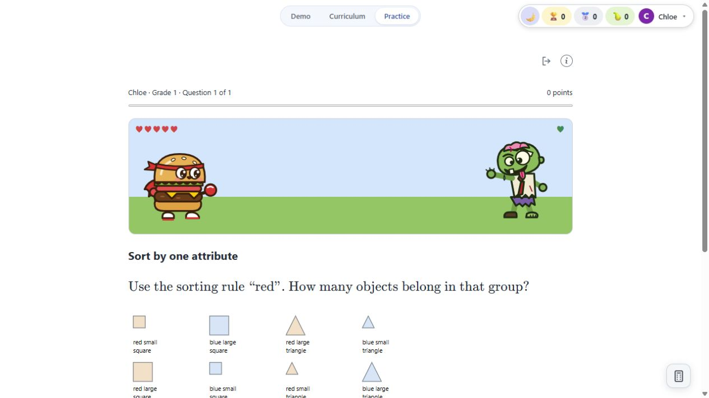

## Grades 1–3

Grades 1, 2, and 3 are available in the curriculum selector, Practice, and printable worksheets, with 45/46/53 expectation entries and 90/93/108 activity templates respectively. Every non-SEL expectation has at least two templates and three distinct stems, varying context, diagrams, unknowns, or reasoning—not just numbers. Primary lessons use counters, sharing strips, patterns, graphs, clocks, Canadian money, and grade-bounded arithmetic. Open-ended construction, discussion, and SEL remain unscored; games select supported numerical questions. See the [research and coverage audit](src/curriculum/data/grades-1-2-3-research.md).

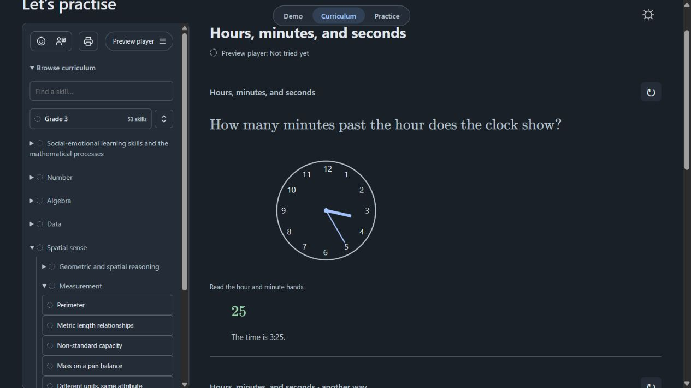

## Player badge, statistics and grade picker

Every page shows the active player as a badge in the top-right corner (a coloured initial or a chosen emoji avatar). Its menu switches player, adds a player (type a name and press Add: the badge changes to the new player at once, and no game starts) or picks an avatar; the choice is stored only on this device. Next to it, three counters summarise the player's saved Practice rounds: 🏆 perfect games, 🥈 games won (at least 80% right) and 🍐 correct answers, and hovering or focusing them shows total accuracy, questions answered, games played and the last-played date. The curriculum grade header joins the grade display and dropdown arrow on one surface: click the grade for its overview or the arrow to reveal the grade choices. Practice uses the same shared grade picker.

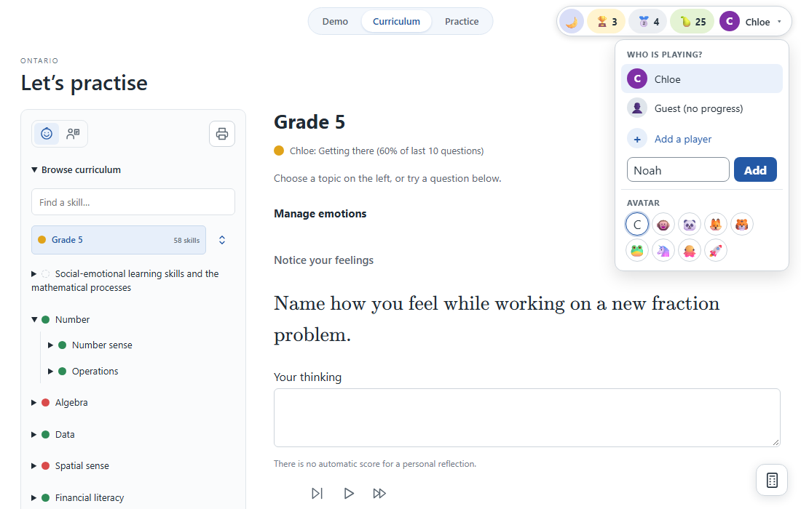

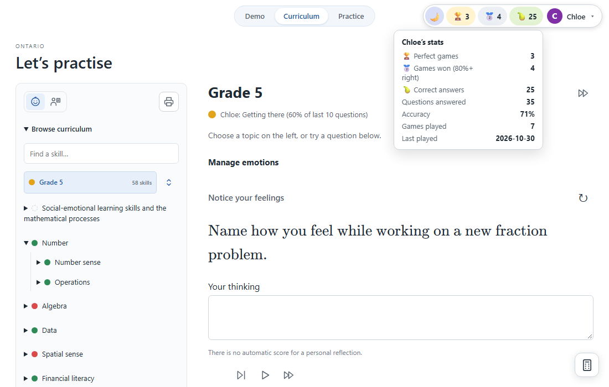

## Grades 9–10

Grade 9 follows the Ontario MTH1W (2021) course with all 43 specific expectations plus the process and social-emotional entries; Grade 10 follows MPM2D (2005) with quadratic relations, analytic geometry and trigonometry. They appear in the curriculum selector, Practice and printable worksheets, with 131 and 116 activity templates. Every non-SEL entry has at least two templates and six distinct stems, built from one registry of 68 teaching rules and 448 styles: calculations, word problems, tables, graphs, checks and judgements. Graphs appear in the worked steps so they never give the answer away. Research, modelling and reporting entries are guided discussions, not scored. See [Grades 9–10 research](src/curriculum/data/grades-9-10-research.md).

Calculator use is deliberate: trigonometry, powers, scientific notation, compound interest and the quadratic formula open it; expanding, factoring and simplifying do not. Trigonometry walkthroughs begin with the manufacturer's angle-mode check (MODE, enter on DEG, clear) and use the multi-tap sin, cos and tan keys (press a key twice for its inverse).

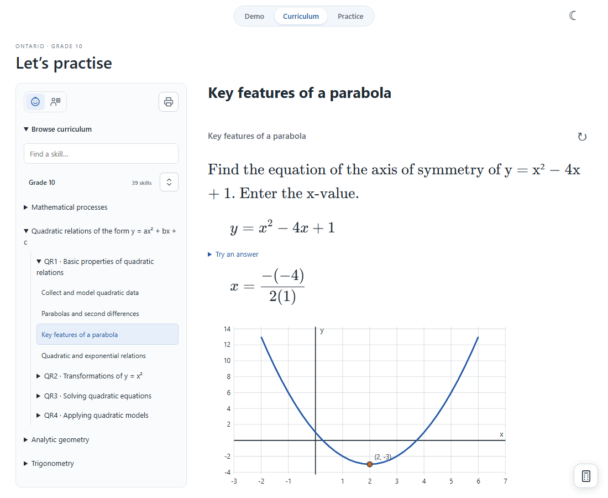

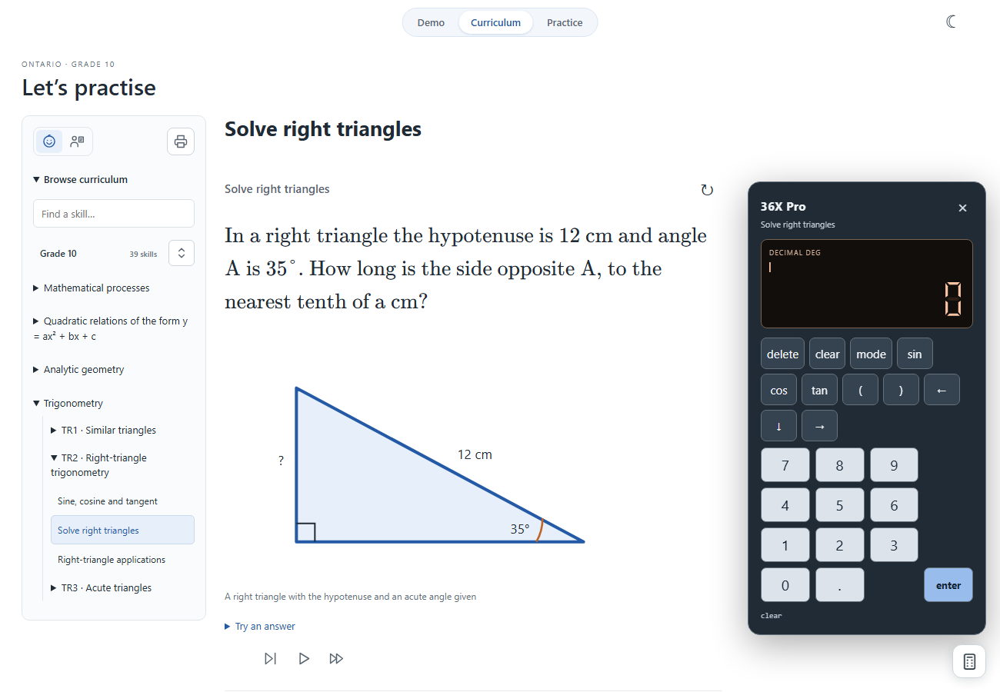

## Calculator and visual demos

The calculator icon opens a 36X Pro-inspired curriculum subset with a seven-segment LED-style display. Relevant learning and practice questions open it automatically; basic counting and clock-reading questions do not. The keypad shows the functions needed by the active question. Keyboard numbers and `+ - * / =` work while it is open, without capturing typing in answer fields.

Suitable worked explanations include a separate calculator-key walkthrough. Play it or advance one key at a time: number, operation, and 2nd/navigation keys use distinct highlights. Unsupported device features are omitted. Arithmetic is exact; pi and non-square roots are marked approximate. The device itself uses an LCD; the LED presentation is specific to this app. See [calculator scope and sources](src/calculator/README.md).

The landing demo now has ten examples. `?slide=6` reads a clock, `?slide=7` applies Pythagoras to a labelled right triangle, `?slide=8` reads a chart, `?slide=9` teaches calculator keys with a percentage question, and `?slide=10` compares ×10ⁿ, EE entry, and SCI display. These reuse Grade 3, Grade 6, and Grade 8 templates and solvers in `src/demo/examples.js`; they are not decorative mock questions. Calculator sequences play during auto-play; interacting with their controls pauses the slideshow for manual practice. The fraction demo uses the n/d template and cursor keys.

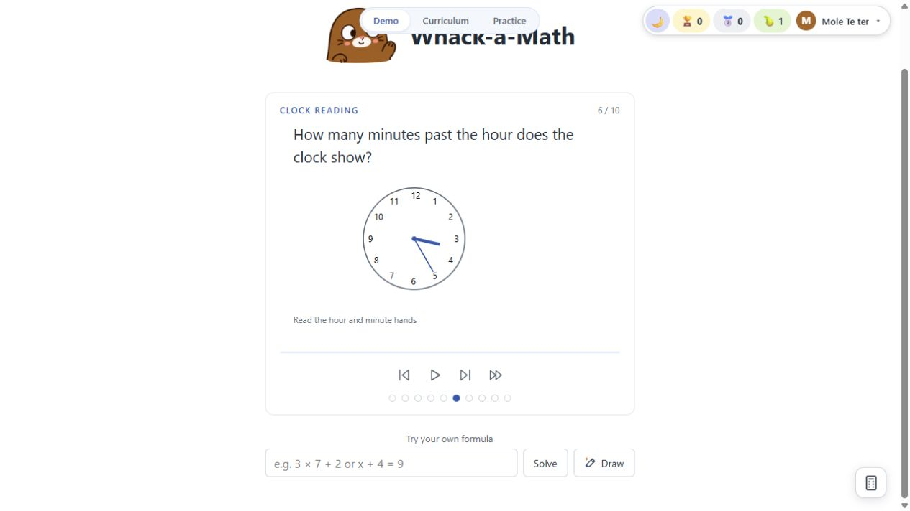

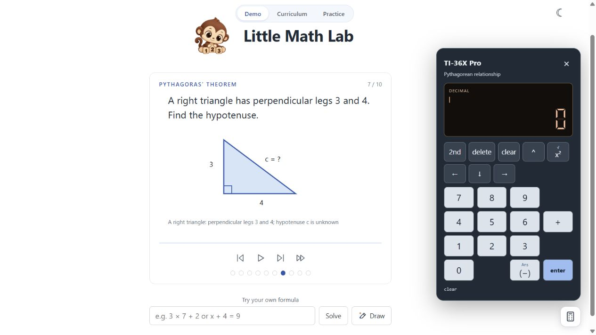

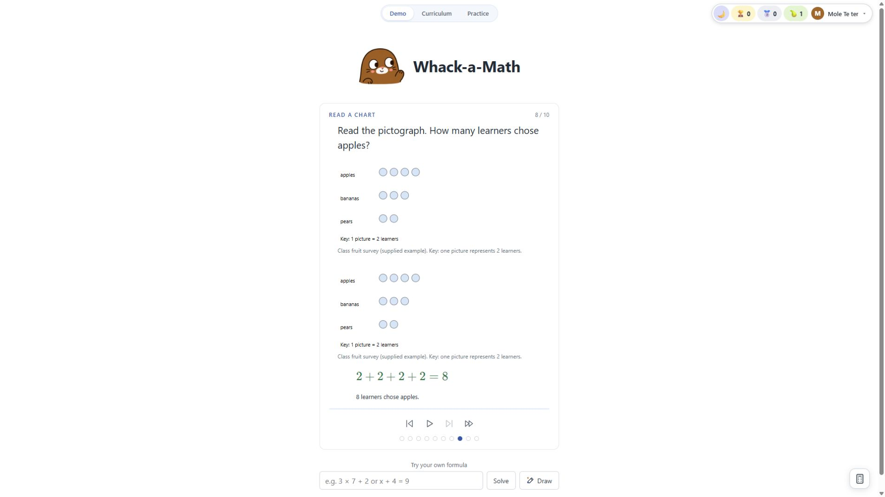

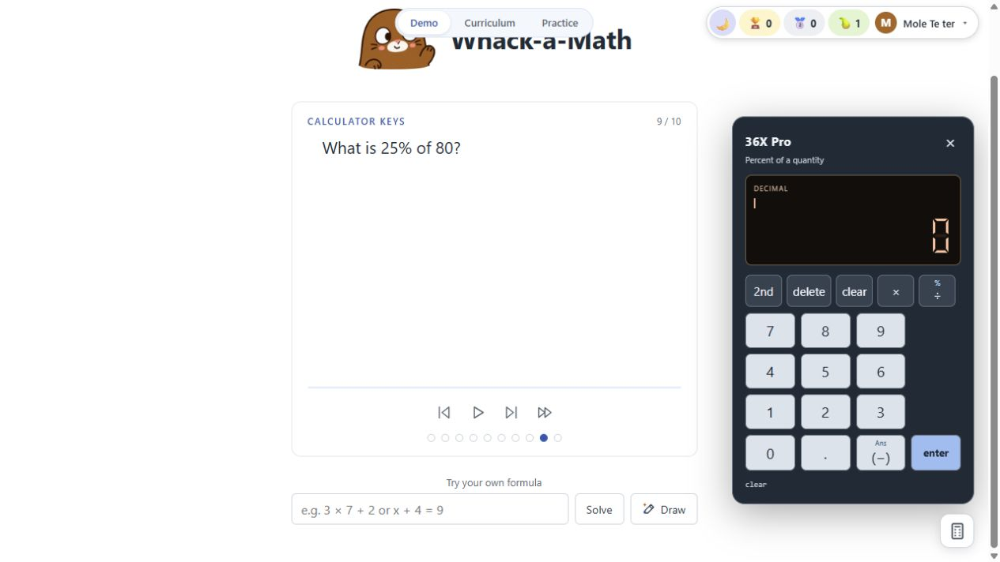

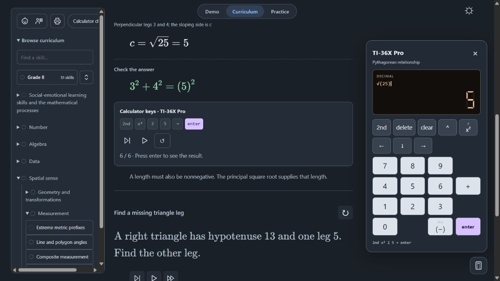

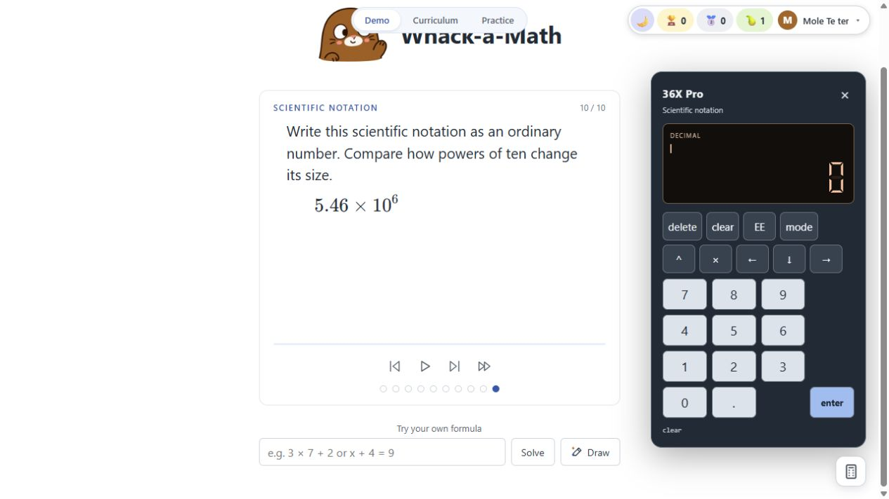

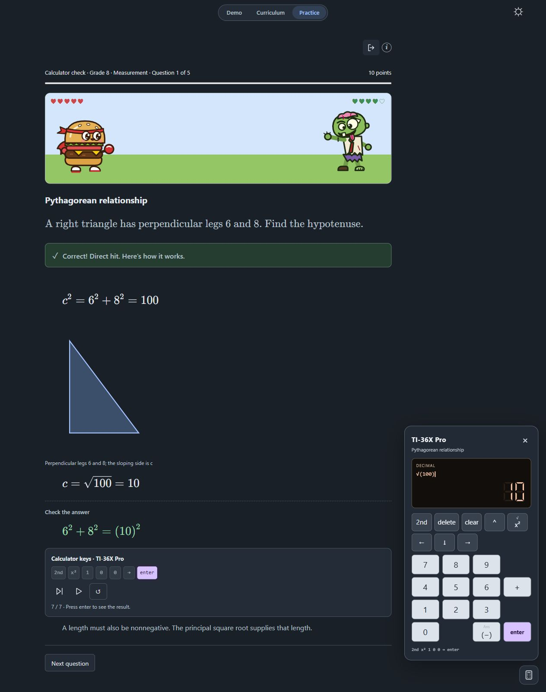

The demo and practice question panes stay in the same position when the calculator opens or closes. Desktop space reservation applies only to the curriculum page.

The waving fifth mole is the Whack-a-Math mascot, landing logo, favicon and PWA icon. Run `pwsh scripts/generate-branding.ps1` to regenerate icon sizes from `public/game-art/moles/mole-5.png`.
