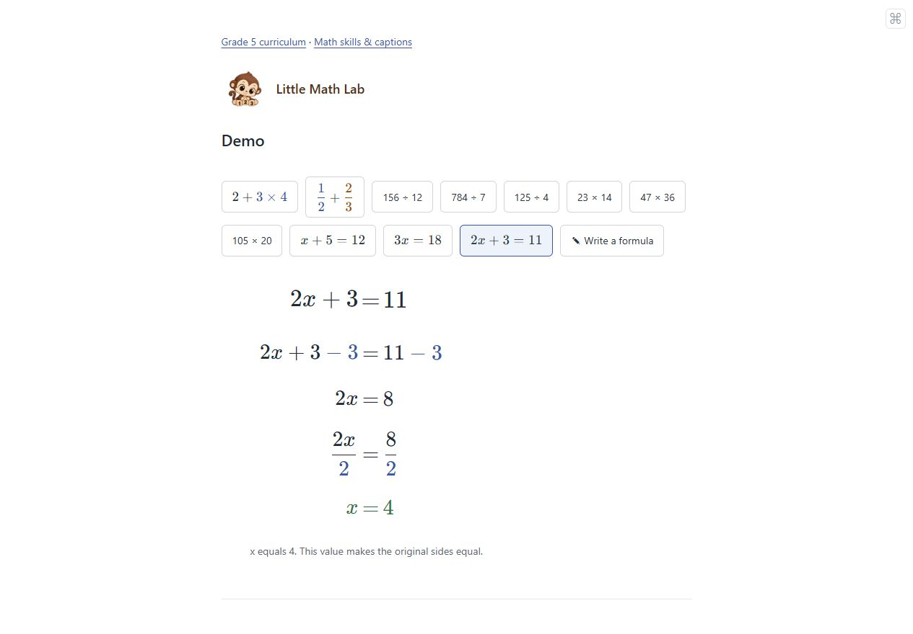
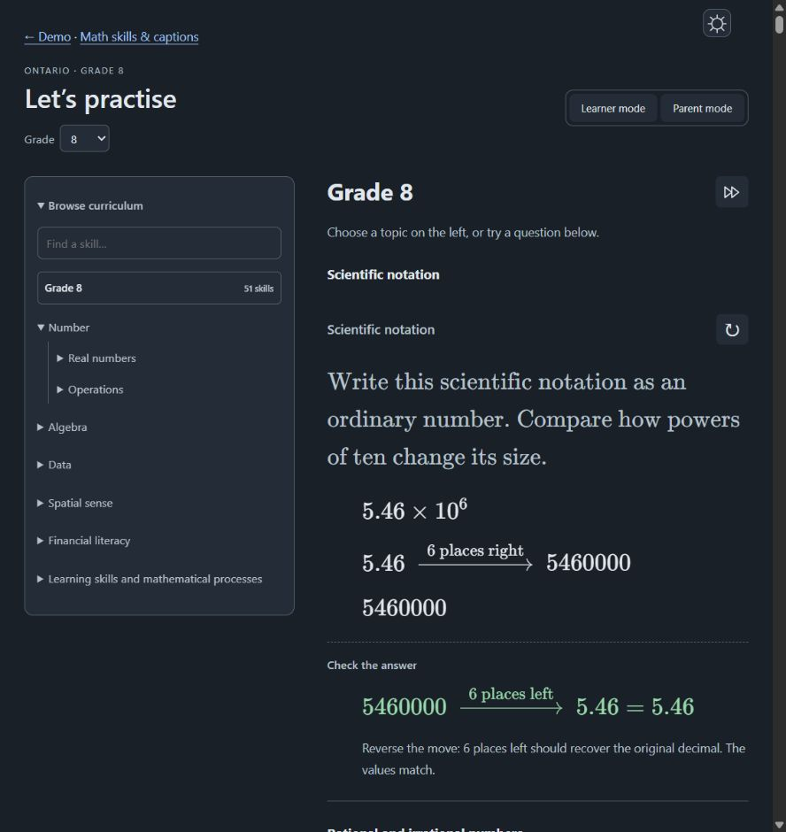
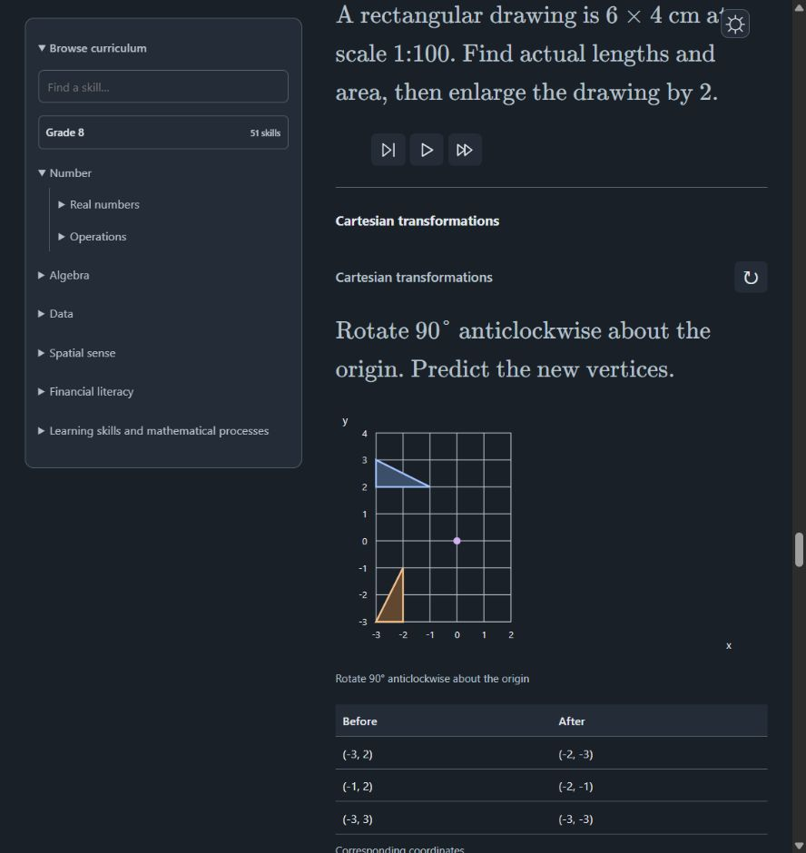

# Little Math Lab

An elementary math prototype with KaTeX formulas and animated, explained steps. No LLM, API key, or backend is used. Recognition and solving are separate: a trained model transcribes ink; exact arithmetic rules solve supported formulas.

[](https://chris-kc-cheng.github.io/math/)

Live site: [chris-kc-cheng.github.io/math](https://chris-kc-cheng.github.io/math/)

## Screenshots

Choose a formula and follow the solution one line at a time.



Browse curriculum skills and reveal worked explanations and answer checks.



Dark mode also keeps diagrams, coordinates, and tables readable.



## GitHub Pages deployment

In the repository's **Settings → Pages**, choose **GitHub Actions** as the source. The [deployment workflow](.github/workflows/deploy-pages.yml) installs dependencies, runs tests, builds the site, and deploys `dist` after pushes to `main`. It can also be run manually from the **Actions** tab on `main`.

The workflow reads the Pages base path from GitHub, so assets and handwriting models work under `/math/` as well as a root or custom-domain deployment. No deployment secret or backend is required.

## Local development

Requires Node.js 20.19+ or 22.12+.

```sh
npm ci
npm run dev
npm test
npm run build
```

Use npm run preview to serve the production build. Open the printed local URL.

The lesson page shows only 2 + 3 × 4 and 1/2 + 2/3. Next step or Play/Pause reveals each new line while earlier lines remain visible. Reduced-motion settings suppress entry animations.

The solver supports two signed integers/decimals with +, -, */×, or /÷; three-term addition with two grouping methods; the bounded a + b × c pattern; and a/b + c/d with integer fraction components. Simple LaTeX fractions and multiplication/division commands work. Simple equations ax + b = c with integer constants and x only on the left are also supported. Other mixed operations, general LaTeX parsing, more general algebra, powers, and roots are unsupported. Answers use reduced exact fractions; division by zero is rejected.

## Trained handwriting recognition

Open write.html via Write a formula. Draw a whole formula in the single pad and review the rendered formula, then Solve. Pen, Eraser, Undo, and Clear are icon controls inside the drawing box. Raw LaTeX and model descriptions are hidden. Read handwriting appears only when Live is off. Editing ink invalidates pending recognition so old results cannot overwrite a changed drawing. The math solver does not gain support for an operation merely because the recognizer can read it.

Recognition uses ink-on 0.1.0 with trained INT8 CoMER encoder/decoder weights and ONNX Runtime Web (CPU/WASM). It runs in a dedicated web worker; no handwriting leaves the browser. This is a specialized handwriting model, not an LLM. A backend is unnecessary. The initial load includes roughly 7.6 MB of model weights plus the WASM runtime. The model is cached in IndexedDB by ink-on; runtime files are bundled by Vite from the installed package, with no CDN dependency. Model provenance and license are in public/models/comer/.

The model supports full expression transcription, including stacked fractions. Recognition is experimental and can be wrong; accuracy on children's handwriting has not been measured. Sample ink is synthetic demonstration data, not an accuracy benchmark. The old geometric template matcher has been removed; sample-ink.js only supplies demo strokes.

npm test runs exact solver tests and a real encoder-to-decoder inference smoke test with the shipped model weights and vocabulary. The inference smoke test validates integration, not handwriting accuracy. Browser checks should additionally cover recognition, correction, stale results, errors, and subsequent solution steps.

Live recognition is enabled by default: after a 650 ms pause following a completed stroke, the latest ink is recognized. Only one inference runs at a time, with changed ink queued for the next pass and stale results discarded. Turn Live recognition off for manual-only reading. Pen/Eraser switches tools; dragging the eraser removes touched whole strokes. Undo restores the previous drawing or erasing gesture (up to 30 actions), including Clear. Use the eraser or redraw to correct the formula.

Landing workflow: choose either sample formula, or open Write a formula to draw in a modal. The handwriting module/model loads only on demand, and closing the modal terminates its worker and pending timers. Use formula transfers recognized LaTeX back to the landing lesson. The rendered selection is visible by default; Edit formula reveals a collapsed-by-default LaTeX/plain-text editor. The old write.html URL redirects to the landing page with the modal open. A tiny debug toggle at the top right opens a session-only right panel with the latest 400 app events, including resource loads, ink edits, debounce state, worker/model initialization, tensor dimensions, inference timings and tokens, stale-result rejection, exact solver outputs, caption steps, playback, and errors. Debug works while the handwriting modal is open and starts collapsed.

The collapsed Edit LaTeX panel is inside the handwriting modal and starts with the current selected formula. Manual edits update its rendered preview and invalidate pending recognition. Use formula applies the edited formula to the landing lesson. The solving section omits the original question and begins with the first transformation.

Long division is available directly in the main demo through the 156 ÷ 12, 784 ÷ 7, and 125 ÷ 4 choices. A standalone long-division.html page is also available. Three examples autoplay divide, multiply, subtract, and bring down in a digit-aligned HTML/CSS layout. The separate BigInt algorithm supports nonnegative whole-number dividends up to six digits and positive divisors up to four digits, returning an integer quotient and remainder. Decimal expansion is not included. Tests check the quotient/remainder identity, zero quotient digits, invalid inputs, and immutable intermediate steps.

The curriculum.html page provides a searchable, selectable Grade 5 hierarchy (58 expectation entries) with strand/topic overviews, skill descriptions, example activities, source links, and shareable selection hashes. Its shared hierarchy and question templates live in src/curriculum/data/. The curriculum inventory and suggested app learning path are separate; no public YRDSB preferred teaching order is claimed. All 58 entries now have worked or guided activities. Learner mode is the default; parent mode shows requirements, sources, and coverage. Refresh generates new questions; completed playback controls disappear.

Long multiplication is available in the main demo for 23 × 14, 47 × 36, and 105 × 20. Its separate exact integer rule handles 0–9999 for each operand, showing digit products, carries, shifted partial products, and column addition. Decimal and signed long multiplication are not included. Tests verify partial-product sums, final results, carrying, zero digits, and immutable snapshots.

Equation demos: x + 5 = 12, 3x = 18, and 2x + 3 = 11 automatically show inverse operations applied to both sides. Equation parsing runs before arithmetic normalization so x remains a variable. Constants must be signed integers; exact rational solutions, zero-coefficient identities, and contradictions are handled explicitly. Variables on both sides, decimal coefficients, arbitrary parentheses, powers, and fractional input constants are rejected.


The Grade 5 library provides 80 activity variants across all 58 entries, grouped by domain in src/math/grade5/. Shared tutorial, visual, and hands-on tools live in src/curriculum/. All calculations are deterministic and bounded; personal reflections and open-ended tasks are not automatically graded. Activities illustrate curriculum skills without claiming exhaustive coverage or mastery. See [src/README.md](src/README.md) for the architecture, named question parameters, tutorial contract, and extension workflow.

Grade 8 is available from the curriculum grade selector or `curriculum.html?grade=8`. Its researched hierarchy has 51 entries and 60 question variants. The shared renderer, exact core and existing Grade 5 rules are reused. See [Grade 8 research](src/curriculum/data/grade-8-research.md) for official Ontario/YRDSB sources, source mapping and coverage limits.

Grades **4, 6, and 7** are also available in the same selector: `curriculum.html?grade=4`, `?grade=6`, and `?grade=7`. Their audited hierarchies contain 55, 58, and 59 expectation entries, with representative worked or guided activities for every entry. All grades use the shared learner/parent views, playback, page-wide fast-forward, dark mode, and exact arithmetic. New mathematical methods are grouped by domain in `src/math/elementary/`; grade-specific content and generation bounds remain in JSON. See [research and coverage audit](src/curriculum/data/grades-4-6-7-research.md). The activities remain partial coverage rather than a claim to assess every context, construction, or learner discussion.
