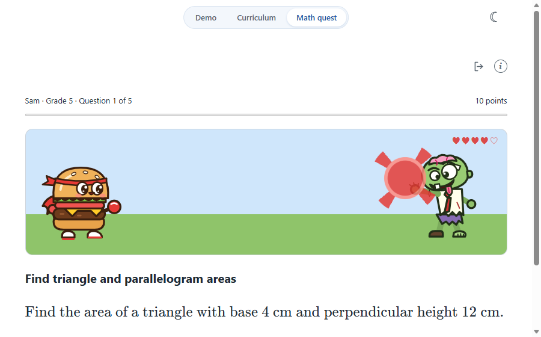
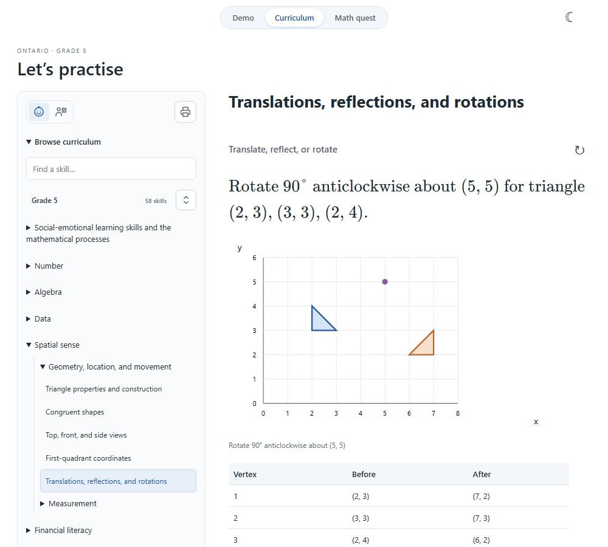
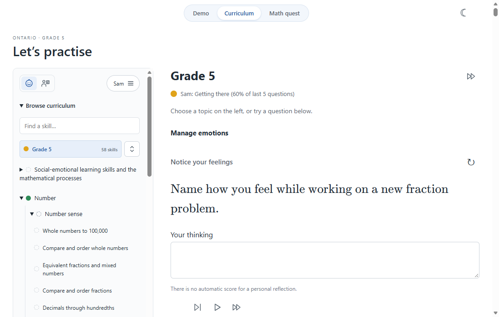
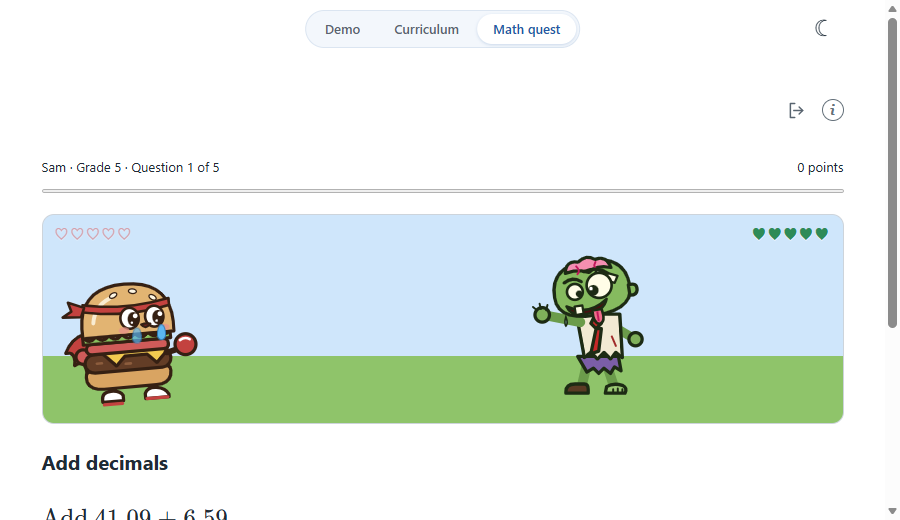

# Little Math Lab

An elementary math prototype with KaTeX formulas and animated, explained steps. No LLM, API key, or backend is used. Recognition and solving are separate: a trained model transcribes ink; exact arithmetic rules solve supported formulas.

[](https://chris-kc-cheng.github.io/math/)

Live site: [chris-kc-cheng.github.io/math](https://chris-kc-cheng.github.io/math/)

## Screenshots

The landing page is a slide show of worked examples. It plays on its own, and can be paused to step manually or to try your own formula.


Browse curriculum skills and reveal worked explanations and answer checks.


Diagrams, coordinates, and tables are drawn alongside the worked steps.

Math quest turns single-answer curriculum questions into a short battle. A correct answer sends a ketchup blob flying across to splat on the zombie.






## GitHub Pages deployment

In the repository's **Settings → Pages**, choose **GitHub Actions** as the source. The [deployment workflow](.github/workflows/deploy-pages.yml) installs dependencies, runs tests, builds the site, and deploys `dist` after pushes to `main`. It can also be run manually from the **Actions** tab on `main`.

The workflow reads the Pages base path from GitHub, so assets and handwriting models work under `/math/` as well as a root or custom-domain deployment. No deployment secret or backend is required.

## Local development

Requires Node.js 20.19+ or 22.12+.

```sh
npm ci
npm run dev
npm test
npm run build
```

Use npm run preview to serve the production build. Open the printed local URL.

The landing page is a card slide show with one worked example per kind of math: order of operations, fractions, long division, long multiplication, and a one-variable equation. It plays automatically (one step about every 1.7 s, then a short hold before the next card). Pause stops it so the learner can step manually (Step, previous/next card, or the dots) or type or draw a formula under Try your own formula; focusing the formula box or opening the handwriting pad pauses automatically. With reduced-motion enabled the show starts paused and entry animations are suppressed.

The solver supports two signed integers/decimals with +, -, */×, or /÷; three-term addition with two grouping methods; the bounded a + b × c pattern; and a/b + c/d with integer fraction components. Simple LaTeX fractions and multiplication/division commands work. Simple equations ax + b = c with integer constants and x only on the left are also supported. Other mixed operations, general LaTeX parsing, more general algebra, powers, and roots are unsupported. Answers use reduced exact fractions; division by zero is rejected.

## Trained handwriting recognition

Open write.html via the Draw button. Draw a whole formula in the single pad and review the rendered formula, then Solve. Pen, Eraser, Undo, and Clear are icon controls inside the drawing box. Raw LaTeX and model descriptions are hidden. Read handwriting appears only when Live is off. Editing ink invalidates pending recognition so old results cannot overwrite a changed drawing. The math solver does not gain support for an operation merely because the recognizer can read it.

Recognition uses ink-on 0.1.0 with trained INT8 CoMER encoder/decoder weights and ONNX Runtime Web (CPU/WASM). It runs in a dedicated web worker; no handwriting leaves the browser. This is a specialized handwriting model, not an LLM. A backend is unnecessary. The initial load includes roughly 7.6 MB of model weights plus the WASM runtime. The model is cached in IndexedDB by ink-on; runtime files are bundled by Vite from the installed package, with no CDN dependency. Model provenance and license are in public/models/comer/.

The model supports full expression transcription, including stacked fractions. Recognition is experimental and can be wrong; accuracy on children's handwriting has not been measured. Sample ink is synthetic demonstration data, not an accuracy benchmark. The old geometric template matcher has been removed; sample-ink.js only supplies demo strokes.

npm test runs exact solver tests and a real encoder-to-decoder inference smoke test with the shipped model weights and vocabulary. The inference smoke test validates integration, not handwriting accuracy. Browser checks should additionally cover recognition, correction, stale results, errors, and subsequent solution steps.

Live recognition is enabled by default: after a 650 ms pause following a completed stroke, the latest ink is recognized. Only one inference runs at a time, with changed ink queued for the next pass and stale results discarded. Turn Live recognition off for manual-only reading. Pen/Eraser switches tools; dragging the eraser removes touched whole strokes. Undo restores the previous drawing or erasing gesture (up to 30 actions), including Clear. Use the eraser or redraw to correct the formula.

Landing workflow: watch the slide show, pause it, then type a formula under Try your own formula or open Draw to sketch it in a modal. `?slide=N` (1–5) opens a specific card. A grouped Demo / Curriculum / Math quest switcher with the current page highlighted sits in the same top-centre position on every page, beside a frameless light/dark toggle. The handwriting module/model loads only on demand, and closing the modal terminates its worker and pending timers. Use formula transfers recognized LaTeX back to the landing lesson. The rendered selection is visible by default; Edit formula reveals a collapsed-by-default LaTeX/plain-text editor. The old write.html URL redirects to the landing page with the modal open. A tiny debug toggle at the top right opens a session-only right panel with the latest 400 app events, including resource loads, ink edits, debounce state, worker/model initialization, tensor dimensions, inference timings and tokens, stale-result rejection, exact solver outputs, caption steps, playback, and errors. Debug works while the handwriting modal is open and starts collapsed.

The collapsed Edit LaTeX panel is inside the handwriting modal and starts with the current selected formula. Manual edits update its rendered preview and invalidate pending recognition. Use formula applies the edited formula to the landing lesson. The solving section omits the original question and begins with the first transformation.

Long division appears in the main slide show (156 ÷ 12), and typing any `NN ÷ NN` with two-or-more-digit whole numbers in Try your own formula uses it too. A standalone long-division.html page is also available. Three examples autoplay divide, multiply, subtract, and bring down in a digit-aligned HTML/CSS layout. The separate BigInt algorithm supports nonnegative whole-number dividends up to six digits and positive divisors up to four digits, returning an integer quotient and remainder. Decimal expansion is not included. Tests check the quotient/remainder identity, zero quotient digits, invalid inputs, and immutable intermediate steps.

The curriculum.html page provides a searchable, selectable hierarchy for Grades 4–8 (Grade 5 has 58 expectation entries) with strand/topic overviews, skill descriptions, example activities, source links, and shareable selection hashes. Its shared hierarchy and question templates live in src/curriculum/data/. The curriculum inventory and suggested app learning path are separate; no public YRDSB preferred teaching order is claimed. All 58 entries now have worked or guided activities. Learner mode is the default; parent mode shows requirements, sources, and coverage. Refresh generates new questions; completed playback controls disappear.

Long multiplication appears in the main slide show (23 × 14), and typing two-or-more-digit whole numbers with × uses it too. Its separate exact integer rule handles 0–9999 for each operand, showing digit products, carries, shifted partial products, and column addition. Decimal and signed long multiplication are not included. Tests verify partial-product sums, final results, carrying, zero digits, and immutable snapshots.

The slide show's equation card (2x + 3 = 11), and typed equations such as x + 5 = 12 or 3x = 18, show inverse operations applied to both sides. Equation parsing runs before arithmetic normalization so x remains a variable. Constants must be signed integers; exact rational solutions, zero-coefficient identities, and contradictions are handled explicitly. Variables on both sides, decimal coefficients, arbitrary parentheses, powers, and fractional input constants are rejected.


The Grade 5 library provides 80 activity variants across all 58 entries, grouped by domain in src/math/grade5/. Shared tutorial, visual, and hands-on tools live in src/curriculum/. All calculations are deterministic and bounded; personal reflections and open-ended tasks are not automatically graded. Activities illustrate curriculum skills without claiming exhaustive coverage or mastery. See [src/README.md](src/README.md) for the architecture, named question parameters, tutorial contract, and extension workflow.

Grade 8 is available from the curriculum grade selector or `curriculum.html?grade=8`. Its researched hierarchy has 51 entries and 60 question variants. The shared renderer, exact core and existing Grade 5 rules are reused. See [Grade 8 research](src/curriculum/data/grade-8-research.md) for official Ontario/YRDSB sources, source mapping and coverage limits.

Grades **4, 6, and 7** are also available in the same selector: `curriculum.html?grade=4`, `?grade=6`, and `?grade=7`. Their audited hierarchies contain 55, 58, and 59 expectation entries, with representative worked or guided activities for every entry. All grades use the shared learner/parent views, playback, page-wide fast-forward, dark mode, and exact arithmetic. New mathematical methods are grouped by domain in `src/math/elementary/`; grade-specific content and generation bounds remain in JSON. See [research and coverage audit](src/curriculum/data/grades-4-6-7-research.md). The activities remain partial coverage rather than a claim to assess every context, construction, or learner discussion.

## Question variety

A skill is practised in several ways so students are not just memorising one wording. `src/math/elementary/variants.js` adds exact-answer variants that take a `style` parameter: word problems with key-word hints for add, subtract, multiply and divide (six stems each, such as "sum", "decreased by", "how much more", "groups of", "shared equally"), missing-number boxes in six equation shapes (□ + a = b, a − □ = b, a × □ = b, and so on), compare-values questions (greater, less, how much greater) and place-value digit questions. They are attached to the whole-number skills in Grades 4–7 and are scored in Math quest and the exercise sheets. A second batch (`src/math/elementary/variants-more.js`) adds textbook-style stems with key-word hints for fractions of a quantity, adding and subtracting fractions in words, decimals in money and measurement, percent of a quantity (discount, tip, increase), unit rates, multiply-then-add and think-of-a-number equations, pattern terms (next, nth, term number, missing term), area and perimeter of rectangles, squares, triangles and parallelograms, metric and time conversions, integers in temperature and bank contexts, powers and square roots, angle relationships, probability in several settings, and the mode or a missing value from the mean. These are attached to the matching skills in Grades 4–8. Every rule is exact, shows a relationship-then-calculation worked solution, and has a test that each style produces the correct answer. Three more batches (`variants-number.js`, `variants-space.js`, `variants-extra.js`) add rounding in context, fraction/decimal/percent conversions, simplifying and comparing fractions, GCF and LCM word problems, divisibility and prime-factor questions, order of operations, decimal patterns and pattern tables, inequalities, like terms, money change, best value, currency exchange, simple and compound interest, budgets, elapsed time, bar graphs and frequency tables read for totals, differences, means and fractions, experimental probability and sample spaces, circles with π ≈ 3.14, volumes and surface areas of prisms and cylinders, composite areas, Pythagorean problems, point transformations, scale lengths, polygon and turn angles, ratio sharing, how a mean changes, scientific notation, square-root estimates, signed integers, sale prices and debts. The Social-Emotional Learning strand is deliberately not given numeric variants. A coverage audit (templates and distinct wordings per skill) is recorded in the review log in `CLAUDE.md`, together with what is still thin.

## Printable exercise sheets

On the curriculum page, the printer icon at the top of the sidebar opens a dialog to build a hard-copy sheet. Choose any mix of strands and topics (or leave all unticked), the number of questions (default 10, up to 50), and whether the answer sheet should also show workings. The sheet lists numbered questions with answer lines, and the answers always come on the last page, either as a compact list or as full worked solutions with the same exact steps shown on screen. It uses the same single-answer questions as Math quest (`src/worksheet-model.js`) and never repeats an identical question. **Create PDF** opens the browser print window on a light layout; choose *Save as PDF* as the destination to keep a file. No backend or PDF library is needed.


## Math quest

`game.html` is a five-question round with the curriculum's single-answer questions (Grades 4–8). Captain Patty fires ketchup at Grumble the zombie: each solved question sends a ketchup blob across the stage to hit him and removes a heart; each wrong try or explored question lets Grumble step closer (never a loss). Hit at least three of five to win, and Grumble is knocked off the screen. Captain Patty also has 5 lives (hearts at top left): each wrong answer costs one, exploring an explanation does not. At zero lives he cries, but he never dies and the round carries on. Setup has two steps. First choose the player (tap a Previous players name, or type one and press Next). Then choose the grade and any mix of topics: tick whole strands such as Algebra or Data, individual topics inside them, or leave everything unticked for all topics. Only topics with automatically checked questions are listed (single-answer Data tasks now include the mean, median or range of five values, and simple probabilities), and the in-round header names the chosen topics. Continue resumes an unfinished round only when its grade and topics match. Scoring is 10 points for a first-try answer and 5 for a retry, and exploring the explanation earns none. The scene is derived from the saved answers (`battleState` in `src/game/model.js`), so resuming a round restores it. Rounds save locally in IndexedDB by player name. Returning players tap their name badge under Previous players, which restores their last grade and topics and moves on to topic selection. Once a round starts, the title, intro and player picker are hidden; a quit icon returns to the picker and the round can be resumed later, and the saving note lives behind an (i) icon that shows on hover or focus. Players also see and see a past-rounds list and Play again; there is no account or backend. Reduced-motion disables the shot and zombie animations. Art is in `public/game-art/`.

**Topics and progress share one panel.** On the topic step every strand and topic is a checkbox row that also carries the player's progress: a coloured dot and "% of last N", based on the share of their last 10 finished questions in that area (solved counts, explored-without-solving does not). Green is Strong (80%+), amber Getting there (50–79%), red Needs practice (under 50%), and a dashed hollow dot means nothing attempted yet. The percentage is always written, so colour is never the only signal. The checklist is two columns and the whole setup (grade, Play and topics) fits on one desktop screen without scrolling. Stats are per player and per grade, computed from the locally saved rounds (`progressTree` in `src/game/model.js`).

The same dots appear on the curriculum page beside every strand, topic and skill the game can score, for the active profile: the one last used in Math quest, or whichever you pick under "Show progress for" (including "No profile", which shows no dots). The grade row summarises every scored question, and skills Math quest cannot score show a lighter dashed circle. The sidebar top bar holds an icon toggle for Learner (a smiley child) and Parent/teacher (a teacher at a board) views and a profile chip that always shows who is active; clicking the chip opens a menu to switch profile (or choose No profile) with the dot legend. Grade is changed with the up/down icon button beside the Grade row, which opens a 4–8 picker. The choice is remembered on this device (`src/game/profile.js`).





